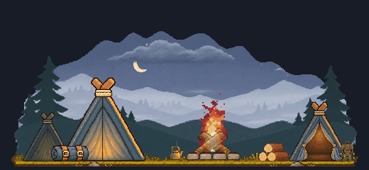

# Moonlit Camp · 月下营地

[English](#en) · [简体中文](#zh-hans) · [繁體中文](#zh-hant) · [日本語](#ja) · [Français](#fr) · [Русский](#ru) · [Español](#es) · [العربية](#ar)



<a name="en"></a>

## English

Moonlit Camp is a small animated pixel-art campsite that sits on your Windows desktop. Watch the sky change throughout the day, the fire flicker, and three tents open, close, and light up on their own schedules. Double-click the campfire to fast-forward to daylight or nightfall.

<a name="zh-hans"></a>

## 简体中文

《月下营地》是一座住在 Windows 桌面上的像素小营地。天空随昼夜变换，篝火轻轻跳动，三座帐篷各自按作息开合、亮灯。双击篝火，可以快进到天亮或入夜。

<a name="zh-hant"></a>

## 繁體中文

《月下營地》是一座住在 Windows 桌面上的像素小營地。天空隨著晝夜變換，營火輕輕跳動，三頂帳篷各自依照作息開門、關門和亮燈。按兩下營火，就能快轉到天亮或入夜。

<a name="ja"></a>

## 日本語

『月夜のキャンプ』は、Windows のデスクトップに広がる小さなドット絵のキャンプ場です。昼夜に合わせて空が移り変わり、焚き火が揺らめきます。3 張りのテントはそれぞれの時間に入口を開け閉めし、明かりを灯します。焚き火をダブルクリックすると、朝や夜まで早送りできます。

<a name="fr"></a>

## Français

Camp au clair de lune est un petit campement animé en pixel art sur votre bureau Windows. Le ciel change au fil de la journée, le feu vacille et les trois tentes s’ouvrent, se ferment et s’allument chacune à leur rythme. Double-cliquez sur le feu pour avancer jusqu’au jour ou à la nuit.

<a name="ru"></a>

## Русский

«Лунный лагерь» — маленький анимированный пиксельный лагерь на рабочем столе Windows. Небо меняется в течение суток, костёр мерцает, а три палатки открываются, закрываются и зажигают свет каждая по своему распорядку. Дважды щёлкните по костру, чтобы приблизить наступление дня или ночи.

<a name="es"></a>

## Español

Campamento a la luz de la luna es un pequeño campamento animado en pixel art para tu escritorio de Windows. El cielo cambia a lo largo del día, la fogata crepita y las tres tiendas se abren, se cierran y se iluminan a su propio ritmo. Haz doble clic en la fogata para avanzar hasta el día o la noche.

<a name="ar"></a>

## العربية

<p dir="rtl" lang="ar">مخيم ضوء القمر هو مخيم صغير متحرك بأسلوب فن البكسل على سطح مكتب ويندوز. تتغيّر السماء على مدار اليوم، وتتراقص ألسنة نار المخيم، وتفتح الخيام الثلاث أبوابها وتغلقها وتضيء كلٌّ منها في أوقاتها الخاصة. انقر مرتين على نار المخيم للتقدّم سريعًا إلى النهار أو الليل.</p>

## Download

Get `MoonlitCamp.exe` from [GitHub Releases](https://github.com/mabuzki/moonlit-camp/releases). The portable build runs on 64-bit Windows with Microsoft Edge WebView2 Runtime. Run the executable and use the system tray icon to show or quit the camp.

The app follows your Windows display language and uses English as a fallback. Right-click the tray icon and open **Language** to choose a language. The app remembers your choice.

## Run from source

Use Node.js 24 and pnpm. A native Windows build also needs Rust with the MSVC toolchain, the C++ build tools, and WebView2. See the [Tauri prerequisites](https://v2.tauri.app/start/prerequisites/).

Download Devkidd’s [Pixel Art Fire Asset Pack v1.2](https://devkidd.itch.io/pixel-fire-asset-pack) and extract the `Pixel fire asset pack v1.2` folder under `assets/third-party/devkidd-pixel-fire/`. The asset preparation script reads the pack’s `Thank you.txt` and the eight original PNGs from `Pixel Fire Asset Pack Colored/fire asset red/Group 6 - 1/`.

```sh
pnpm install --frozen-lockfile
pnpm dev
```

Run `pnpm tauri dev` for the native window or `pnpm tauri build --no-bundle` to compile the portable executable.

## Credits

- Campfire animation from Devkidd’s [Pixel Art Fire Asset Pack v1.2](https://devkidd.itch.io/pixel-fire-asset-pack).
- Campfire audio uses the first 24 seconds of [fire wood bonfire high eq.aif](https://freesound.org/people/homejrande/sounds/17374/) by homejrande, edited into a loop under [CC BY-NC 3.0](https://creativecommons.org/licenses/by-nc/3.0/).
